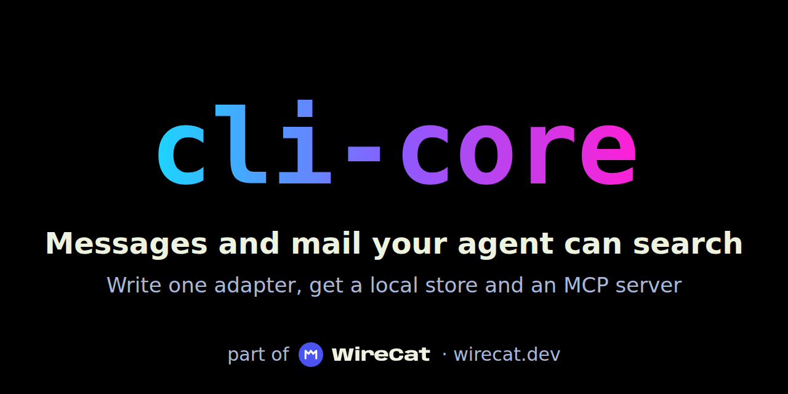
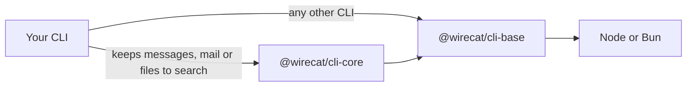
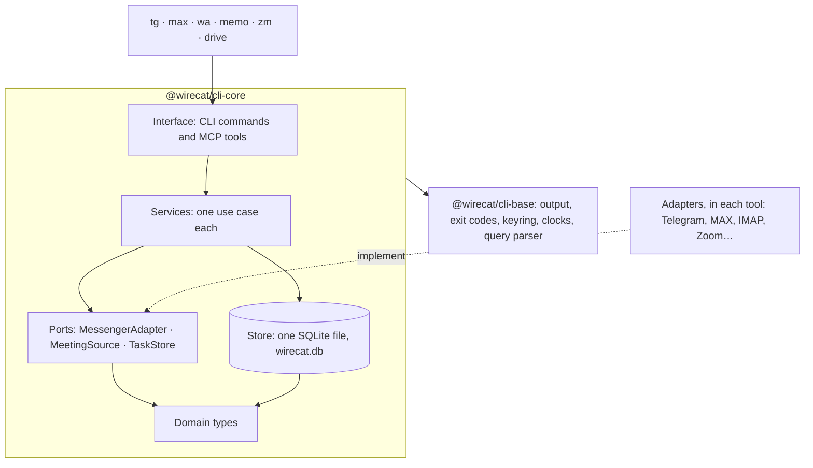

<p align="center">
  
</p>

# @wirecat/cli-core

Build a CLI that lets people and AI agents search a messenger, a mailbox or any service with a history, in
TypeScript on Node or Bun. You write the adapter that talks to the service, and cli-core gives it a local store with
search, the shared commands and an MCP server.

```ts
import { type Messenger, mcpCommand, messagesCommand, run, searchCommand, settingsFor } from "@wirecat/cli-core/cli"
import { acmeAdapter } from "./adapter.js" // your code: the only part that speaks to Acme Chat

const app = { command: "acme", appName: "acme-cli", envPrefix: "ACME", description: "Acme Chat", version: "0.1.0" }
const settings = settingsFor(app)

const acme: Messenger = {
  app,
  provider: "acme",
  resolveSettings: settings.resolveSettings,
  connect: async () => acmeAdapter(),
  chatArgument: "a chat: its name or its Acme id",
}

process.exitCode = await run(process.argv.slice(2), {
  app,
  configuration: settings,
  commands: () => [messagesCommand(acme), searchCommand(acme), mcpCommand(acme)],
})
```

```sh
acme personal messages sync --all                  # every chat's history into the local store
acme personal search messages come --json=excerpt  # {"items":[{"excerpt":"are you coming?",…}],…}
acme personal mcp check                            # {"item":{"healthy":true,…,"tools":3,…},…}
```

That output is real, from this program with the in-memory `fakeAdapter` of `@wirecat/cli-core/testing` in place of
Acme. The search found "are you coming?" from the word "come", with no network.

**Built on it:** [tg-cli](https://github.com/WireCatLabs/tg-cli), [max-cli](https://github.com/WireCatLabs/max-cli),
[gcal-cli](https://github.com/WireCatLabs/gcal-cli) and 12 more WireCat CLIs, such as the mail and notes tool
[cli-memo](https://github.com/WireCatLabs/cli-memo), the [WhatsApp tool](https://github.com/WireCatLabs/whatsapp-cli),
[zoom-cli](https://github.com/WireCatLabs/zoom-cli) and [drive-cli](https://github.com/WireCatLabs/drive-cli).

## Install

```sh
npm install --save-exact @wirecat/cli-core
```

npm 7+ and pnpm also install its peers: `@wirecat/cli-base` in the range `package.json` names, and `commander` 15.
`@napi-rs/canvas` is optional, and charts need it only for PNG output. It runs on Node 22.16+ and 24+, and on Bun.
The stable API follows semver. Names marked `@experimental`, and the entry points outside `wirecat.stable`, may
change in a minor ([Build on it](#build-on-it)).

[Architecture](docs/dev/ARCHITECTURE.md) · [Write an adapter](docs/dev/ADAPTERS.md) ·
[Query language](docs/search/query-language.md) · [Messenger rules](docs/dev/STANDARD.md) ·
[API reference](docs/REFERENCE.md) · [Changelog](CHANGELOG.md) · [wirecat.dev](https://wirecat.dev)

[](https://www.npmjs.com/package/@wirecat/cli-core)
[](https://github.com/WireCatLabs/cli-core/actions/workflows/ci.yml)
[](https://nodejs.org/)
[](https://bun.sh/)
[](LICENSE)

## Which package to install



cli-core is for a tool that keeps what it reads in a local store and searches it. It is built on
[`@wirecat/cli-base`](https://github.com/WireCatLabs/cli-base), the layer every CLI needs: two output streams, closed
error codes, the keyring, injectable clocks and the query parser. cli-base is a peer dependency, so an install holds
one copy. A CLI with nothing to store needs only cli-base.

## Features

- **Search that finds the message, not only the word.** One query language for every list and every source, a
  TypeScript port of the Apache Lucene 9.12.3 parsers: phrases, `from:(alice OR bob)`, `date:[2026-01-01 TO
  2026-02-01}`, `size>10MB`. Word forms in Russian, English and Spanish (`встреча` finds `встречи`), any three letters
  inside a word, and search by meaning when you opt in. A question over 100,341 synthetic messages took 54 ms at the
  median ([measured](https://github.com/WireCatLabs/cli-testing/blob/main/performance/search/model-free/FRESH-VALIDATION.md#archive-size-latency-and-query-ram),
  [every search measurement](https://github.com/WireCatLabs/cli-testing/tree/main/performance/search)).
  [Syntax](docs/search/query-language.md) · [grammar](docs/search/query-language-spec.md) ·
  [image search](docs/search/images.md)
- **One store for every source.** Messages from Telegram and MAX, mail, notes and meeting transcripts sit side by side
  in one SQLite file, `wirecat.db`, so one query searches all of them. Edits are kept as revisions and deletions as
  tombstones. Migrations only move forward, and an older CLI keeps reading a file a newer one migrated.
  [Storage](docs/storage/README.md) · [why SQLite FTS5 and no daemon](docs/storage/decisions.md)
- **An MCP server that leaves room in the agent's context.** The shared commands reach an agent as 3 MCP tools: find a
  command, run a read, run a write. It runs over stdio, or over HTTP on 127.0.0.1 behind the owner's tunnel with a
  one-owner OAuth login.
- **Every write behind a guard.** A permission level per command path (deny, readonly, ask or allow), a list of
  allowed recipients, and at most 30 sends an hour by default. A write whose outcome is unknown is never retried, and
  a retry under the same send id cannot send twice.
- **Knowledge, tasks and meetings across sources.** What an agent proposes stays proposed until the owner accepts it.
  Tasks have project keys like `RES-12`, and a meeting transcript is kept by revision.
  [Knowledge](docs/dev/KNOWLEDGE.md) · [Meetings](docs/dev/MEETINGS.md) · [Mentions](docs/mentions.md)
- **Files and voice as text.** Readers for PDF, Word, HTML and more, each loaded on first use, and speech recognition
  on your computer from a pinned model catalogue. [Document workflows](docs/dev/DOCUMENTS.md) ·
  [Media archives](docs/dev/MEDIA-ARCHIVE.md)

## How it works



Five layers, and each calls only the layers below it: domain, adapters behind a port, ports, services, interface.

- **The CLI and the MCP server are two adapters over the same services.** A command and its MCP tool answer with
  the same data, because one service produces it.
- **A port with one required core and optional groups.** `MessengerCore` is what every messenger must do. Groups such
  as polls or forums are optional and reached through `capability()`. A messenger without a group refuses the command
  before it connects. It never crashes and never drops an option in silence.
- **Override a use case, not a command.** A tool replaces one service through `Messenger.services`, and every command
  and tool that uses it follows.
- **The build keeps the lines.** Biome import rules refuse any messenger library under `src/`, `commander` in a
  service, and the SQLite tables outside the store. Tests refuse a gap in the migration numbers and a search plan that
  reads an index once per message.

## Build on it

A new messenger is three pieces: an adapter that implements `MessengerCore` (and any optional groups), a
`Messenger` that describes it, and the contract cases run against it. The
[adapter guide](docs/dev/ADAPTERS.md) walks through each one.

This runs as it is under vitest and gives 29 cases. `fakeAdapter` is the in-memory adapter the kit ships. Put your own
adapter there, built over a fake client filled from `seed`. The `./testing` kit is not stable yet.

```ts
import { contractCases, digitIds, fakeAdapter } from "@wirecat/cli-core/testing"
import { describe, it } from "vitest"

describe("the adapter keeps the port's promises", () => {
  for (const one of contractCases({ connect: (seed) => fakeAdapter(seed), ids: digitIds }))
    it(one.name, async (context) => {
      const result = await one.run()
      if (result) context.skip(result.skipped)
    })
})
```

**The stable API follows semver from 1.0.0.** The entry points in `wirecat.stable` (`package.json`) are stable,
except the names whose doc comment says `@experimental`; a break of them needs a major. Everything else is
experimental and may change in a minor, and releases are frequent, sometimes several a day. The
[changelog](CHANGELOG.md) lists every change that needs one, with what to change. Using only stable names, `^1.0.0` is
safe; using experimental ones, pin an exact version, as tg-cli and max-cli do.
The full list of entry points and what each holds is in the [API reference](docs/REFERENCE.md).

⚠ **Errors are recognised by shape, not by class** (`isCliFailure`). A package linked during development brings its
own copy of cli-base, and an error built by one copy is not an `instanceof` the other's class.

## Engineering standards

The [WireCat CLI standards handbook](https://github.com/WireCatLabs/cli-base/blob/main/docs/standards/README.md) in
cli-base binds every WireCat CLI, and the [messenger rules](docs/dev/STANDARD.md) add what binds tg, max and wa. They
measure themselves against POSIX, GNU, [Command Line Interface Guidelines](https://clig.dev), the MCP specification
and JSON Schema 2020-12, and say where they differ on purpose.

- **Tests that cannot touch real data.** A sandbox keeps every test away from the owner's store, and no test may
  sleep. The coverage floor is 92% of lines, and at least half of every file.
- **Checked against the tools that use it.** Every pull request builds tg-cli, max-cli, whatsapp-cli and
  cli-template against the branch. Which checks run on macOS and Windows is in
  [Testing](docs/dev/TESTING.md#platforms).
- **One shared toolchain.** Biome, markdownlint, CSpell and Lefthook configs come from the
  [WireCat standards](https://github.com/WireCatLabs/community/blob/main/standards/README.md), and CI fails when a
  copy drifts.

## Development

```sh
pnpm install
pnpm lint && pnpm typecheck && pnpm test
pnpm smoke:bun    # the same exports, run under Bun
```

**A CLI built on cli-core needs the `-dev` release for its types.** The `X.Y.Z` that users install has no type files.
Each release also publishes `X.Y.Z-dev`: the same code with `.d.ts` files, maps and `src/`. Keep
`"@wirecat/cli-core": "X.Y.Z"` in `package.json`, and add `"@wirecat/cli-core": X.Y.Z-dev` under `overrides:` in
`pnpm-workspace.yaml`. Your users still get `X.Y.Z`: pnpm reads that file only in the project it installs, and npm and
Bun never read it. Without that line, `tsc` fails with TS7016, "Could not find a declaration file for module
'@wirecat/cli-core'". How the pair is built is in [Architecture](docs/dev/ARCHITECTURE.md#the-two-packages-of-a-release).

Releases go through `bin/release` from `main`. It refuses a dirty tree, runs every check, publishes to npm and tags
`v<version>`. The steps and the release rules are in [RELEASING.md](docs/dev/RELEASING.md).

## Key documents

| Document | What it answers |
|---|---|
| [Architecture](docs/dev/ARCHITECTURE.md) | The layers, the module map, the store internals and migrations, who consumes what |
| [Document workflows](docs/dev/DOCUMENTS.md) | Shared file ingestion, sync, scoped knowledge and extraction, and the ports a file provider supplies |
| [Media archives](docs/dev/MEDIA-ARCHIVE.md) | Independent verified file copies, interruption recovery and opt-in daily timers |
| [Write an adapter](docs/dev/ADAPTERS.md) | How to add a messenger: the port, the `Messenger` description, the contract cases |
| [Messenger rules](docs/dev/STANDARD.md) | What binds tg, max and wa beyond the [CLI standards handbook](https://github.com/WireCatLabs/cli-base/blob/main/docs/standards/README.md): parity, the option catalogue, `bot` |
| [Glossary](docs/dev/GLOSSARY.md) | One word, one meaning across the tools |
| [Query language](docs/search/query-language.md) · [spec](docs/search/query-language-spec.md) · [Image search](docs/search/images.md) | The search syntax and its exact grammar, and finding pictures by context and by what they show |
| [Mentions](docs/mentions.md) · [how they work](docs/dev/MENTIONS.md) | Phones, e-mail, links, documents and names found in messages: search, review, rebuild, the tables and the rules |
| [Storage](docs/storage/README.md) | The schema, the search indexes and the decisions behind them |
| [Knowledge](docs/dev/KNOWLEDGE.md) · [Meetings](docs/dev/MEETINGS.md) | Labels, links and proposals across sources, the meetings module and its providers |
| [Testing](docs/dev/TESTING.md) · [Parity audit](docs/dev/PARITY-AUDIT.md) | The sandbox, the coverage floor, the checks across tg and max |
| [Tool boundaries](docs/dev/TOOL-BOUNDARIES.md) | Which tool owns which command |
| [API reference](docs/REFERENCE.md) | Every entry point and the detailed contract of each feature |
| [Roadmap](docs/roadmap.md) | What is being built next for developers on this package |
| [Changelog](CHANGELOG.md) | What each version changed, and what may break callers |

## History

Up to 0.261.0 the package was named `@wirecat/cli-messaging`, which is deprecated. The npm versions 0.0.0-stage, 0.0.0
and 0.18 to 0.20 of `@wirecat/cli-core` are deprecated too: they are placeholders and the old cli-base.

## Licence

[Apache License 2.0](LICENSE).
