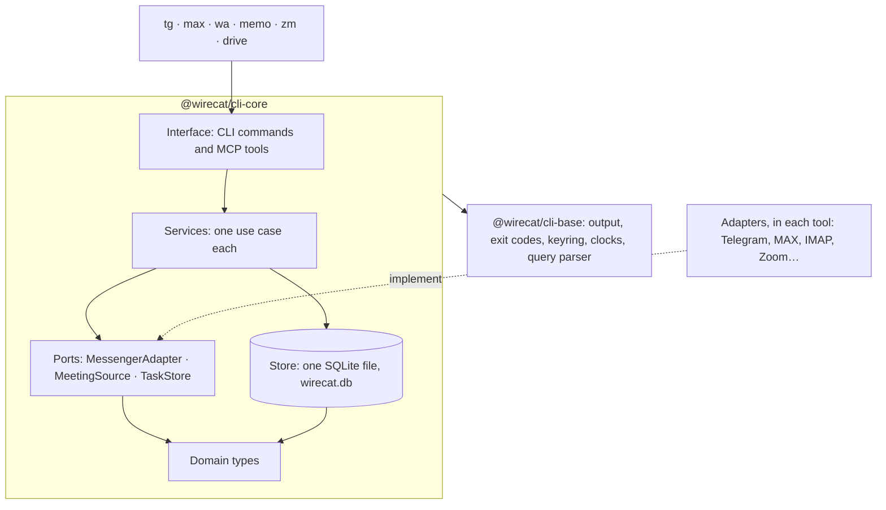

<p align="center">
  
</p>

# @wirecat/cli-core

The engine behind the WireCat command-line tools for Telegram, MAX, WhatsApp, mail, notes, meetings and Google
Drive. Everything that
does not depend on one messenger lives here: the data model, a local SQLite store with full-text and semantic
search, a Lucene query language, the shared commands, an MCP server for AI agents, and the guard around every
write. A messenger plugs in as one adapter and gets all of it.

[Architecture](docs/dev/ARCHITECTURE.md) · [Write an adapter](docs/dev/ADAPTERS.md) ·
[Query language](docs/search/query-language.md) · [Messenger rules](docs/dev/STANDARD.md) ·
[API reference](docs/REFERENCE.md) · [Changelog](CHANGELOG.md) · [wirecat.dev](https://wirecat.dev)

[](https://www.npmjs.com/package/@wirecat/cli-core)
[](https://github.com/WireCatLabs/cli-core/actions/workflows/ci.yml)
[](https://nodejs.org/)
[](https://bun.sh/)
[](LICENSE)

## Key documents

| Document | What it answers |
|---|---|
| [Architecture](docs/dev/ARCHITECTURE.md) | The layers, the module map, the store internals and migrations, who consumes what |
| [Document workflows](docs/dev/DOCUMENTS.md) | Shared file ingestion, sync, scoped knowledge and extraction; the ports a file provider supplies |
| [Media archives](docs/dev/MEDIA-ARCHIVE.md) | Independent verified file copies, interruption recovery and opt-in daily timers |
| [Write an adapter](docs/dev/ADAPTERS.md) | How to add a messenger: the port, the `Messenger` description, the contract cases |
| [Messenger rules](docs/dev/STANDARD.md) | What binds tg, max and wa beyond the [CLI standards handbook](https://github.com/WireCatLabs/cli-base/blob/main/docs/standards/README.md): parity, the option catalogue, `bot` |
| [Glossary](docs/dev/GLOSSARY.md) | One word, one meaning across the tools |
| [Query language](docs/search/query-language.md) · [spec](docs/search/query-language-spec.md) · [Image search](docs/search/images.md) | The search syntax and its exact grammar; finding pictures by context and by what they show |
| [Mentions](docs/mentions.md) · [how they work](docs/dev/MENTIONS.md) | Phones, e-mail, links, documents and names found in messages: search, review, rebuild; the tables and the rules |
| [Storage](docs/storage/README.md) | The schema, the search indexes and the decisions behind them |
| [Knowledge](docs/dev/KNOWLEDGE.md) · [Meetings](docs/dev/MEETINGS.md) | Labels, links and proposals across sources; the meetings module and its providers |
| [Testing](docs/dev/TESTING.md) · [Parity audit](docs/dev/PARITY-AUDIT.md) | The sandbox, the coverage floor, the checks across tg and max |
| [Tool boundaries](docs/dev/TOOL-BOUNDARIES.md) | Which tool owns which command |
| [API reference](docs/REFERENCE.md) | Every entry point and the detailed contract of each feature |
| [Roadmap](docs/roadmap.md) | What is being built next for developers on this package |
| [Changelog](CHANGELOG.md) | What each version changed, and what may break callers |

## What it is

A messaging CLI has two halves. One speaks a protocol: MTProto for Telegram, a WebSocket for MAX, IMAP for mail.
The other half is the same for every messenger: store what was read, search it, render it for a person and as JSON
for a program, guard every send, expose it all to an agent. This package is the second half.

[tg-cli](https://github.com/WireCatLabs/tg-cli), [max-cli](https://github.com/WireCatLabs/max-cli) and
the [WhatsApp tool](https://github.com/WireCatLabs/whatsapp-cli) are built on it, and so are the mail and notes tool
[cli-memo](https://github.com/WireCatLabs/cli-memo), [zoom-cli](https://github.com/WireCatLabs/zoom-cli) and
[drive-cli](https://github.com/WireCatLabs/drive-cli). They import it as `@wirecat/cli-core`. Up to 0.261.0 the package
was named `@wirecat/cli-messaging`, which is deprecated. The npm versions 0.0.0-stage, 0.0.0 and 0.18–0.20 of
`@wirecat/cli-core` are deprecated too: they are placeholders and the old cli-base.

**Who it is for.** First of all, it is the engine of the WireCat tools, and it changes as fast as they need. You can
build your own messenger CLI on it, but expect to follow a moving API (see [Build on it](#build-on-it)).

```sh
npm install --save-exact @wirecat/cli-core
```

npm 7+ and pnpm also install its peers: `@wirecat/cli-base` in the range `package.json` names, and `commander` 15 or
later. `@napi-rs/canvas` is optional; charts need it only for PNG output.

It is built on [`@wirecat/cli-base`](https://github.com/WireCatLabs/cli-base), the layer every CLI needs: two output
streams, closed error codes, the keyring, injectable clocks, the query parser. cli-base is a peer dependency, so an
install holds one copy.

It has 26 entry points (the `exports` of `package.json`), 27 search fields and 13 search presets.
It runs on Node 22.16+ and 24+, and on Bun.

## Architecture



Five layers, and each calls only the layers below it: domain, adapters behind a port, ports, services, interface.

- **The CLI and the MCP server are two adapters over the same services.** A command and its MCP tool answer with
  the same data, because one service produces it.
- **A port with one required core and optional groups.** `MessengerCore` is what every messenger must do. The other
  groups — server reads, polls, forums, reactions and the rest — are optional and reached through `capability()`.
  A messenger without a group refuses the command before connecting; it never crashes and never silently drops an
  option.
- **Decorators, so no service can forget.** Every adapter is wrapped twice: `stored` saves what a read answered,
  and `observed` times each call for the run record.
- **Override a use case, not a command.** A tool replaces one service through `Messenger.services`; every command
  and tool that uses it follows.
- **Tasks and meetings know nothing of SQLite.** They define their own ports (`TaskStore`, `MeetingStore`), and the
  store implements them.

**The build enforces these boundaries.** Biome import rules refuse, under `src/`:

- any messenger library or adapter — this package speaks no provider;
- `commander` or a command file in services, sends or MCP;
- the SQLite table modules anywhere outside the store's own interface;
- any import from the rest of the package inside tasks and meetings, and any file system or SQLite there.

Tests guard the rest. Migrations must be numbered without gaps and may not rebuild a table. The schema spec, the
code and its document must agree. A search plan that reads an index once per message fails the build.

## Features

### Search that finds it

- **One query language for every list and every source.** A TypeScript port of the Apache Lucene 9.12.3 parsers,
  with no runtime parser dependency. Phrases, `AND` / `OR` / `NOT`, `+required`, grouping, field groups like
  `from:(alice OR bob)`, ranges `date:[2026-01-01 TO 2026-02-01}`, comparisons `size>10MB`, wildcards and regular
  expressions. 27 fields: sender, chat, date, file name, MIME type, transcript, subject, label and more.
  Proximity `"invoice paid"~3` finds the words close together in one message; the fuzzy operator `word~1` is
  refused with an error that names the alternative.
  [Syntax](docs/search/query-language.md) · [grammar](docs/search/query-language-spec.md)
- **Any three letters inside a word.** An FTS5 trigram index finds `port` inside `report`. A
  second, word index ranks by BM25.
- **Word forms in three languages.** Snowball 3.1.1 stemmers for Russian, English and Spanish: `встреча` finds
  `встречи`. Exact forms rank first; `exact:` turns stemming off.
- **Safe regular expressions.** A Thompson NFA without backtracking, with budgets for states and work, so no
  pattern can hang the search.
- **Presets for what people actually look for.** `preset:password`, `api-key`, `card`, `phone`, `email`, `url` and
  seven more find candidates, labelled as candidates.
- **Search by meaning, opt in.** Conversations are split into chunks and embedded locally by ONNX Runtime — native
  on Linux (glibc) and Apple-silicon Macs once `models download` has fetched it, WebAssembly elsewhere, on Node and
  Bun alike — e5-small by default, or any OpenAI-compatible API with your own key, after
  you see the cost. Results by meaning and by words are merged by reciprocal rank fusion.
- **The archive and the server together.** `--backend both` also asks the messenger's own search; its hits are saved
  and filtered by the same query, so nothing is counted twice. `--thread` brings the reply thread around a hit.
- **Bounded by design.** Query size, depth, nodes, pattern length, expansions and run time all have limits.

Measured on synthetic data ([methodology and results](https://github.com/WireCatLabs/cli-testing/tree/main/performance/search)):

| Stored messages | Search p50 / p95 |
|---|---|
| 10,341 | 9.0 / 22.6 ms |
| 100,341 | 53.9 / 107.6 ms |

### One local store for every source

- **One file, every messenger and account:** `wirecat.db` in `~/.local/share/WireCat/` (`%LOCALAPPDATA%\WireCat\Data\`
  on Windows). Messages from Telegram and MAX, mail, notes and meeting transcripts sit side by side, so one query
  searches all of them.
- **`node:sqlite` under Node and `bun:sqlite` under Bun,** behind a small seam. WAL and a busy timeout on both.
- **History you can trust.** Edits are kept as revisions and deletions as tombstones. Every sender is an identity
  with a person of their own, so one person across two messengers can be linked.
- **Migrations an older build survives.** Forward-only, additive and frozen once released. `min_compatible` lets an
  older CLI keep using a file a newer one migrated, and refuses a file it cannot read.
- **Built for the long run.** History download is resumable and respects the messenger's rate limits; it can run in
  the background as a job. `store check`, `backup` and `restore` look after the file itself.

[Storage](docs/storage/README.md) · [why SQLite FTS5 and no daemon](docs/storage/decisions.md)

### A full CLI and an MCP server from one adapter

Describe a messenger once — its name, how to connect, how `me` maps to a chat — and the tool gets about sixty
shared commands: chats, contacts, messages, search, reactions, polls, the inbox of unread messages, `watch` for live
updates, history download, the store, run records, configuration, shell completion, `doctor`, and `commands --json`,
the whole command tree as data for an agent.

The same commands become MCP tools for agents without a terminal. The server offers three tools — find a command,
run a read, run a write — so an agent's context does not fill with a hundred tool schemas. It runs over stdio, or
over HTTP on 127.0.0.1 behind the owner's tunnel, with a one-owner OAuth login.

`serve` keeps the store current, one process per profile by a lock file; `server install` adds a systemd user unit
or a launchd agent.

### Every write behind a guard

- **A permission level per command path:** deny, readonly, ask or allow. The most specific key wins, and a built-in
  default can only tighten what the owner set. No level lets an agent delete for everyone.
- **A recipient list and an hourly limit** for sends, and a journal of every attempt that records the length of the
  text, never the text. Each photo or file of an album counts as one send.
- **A send id across retries.** A write whose outcome is unknown is never retried automatically; a retry under the
  same send id cannot send twice.
- **Deletion asks first,** at most ten messages at a time.
- **MCP writes follow the same profile permissions.** An agent sees only the tools the profile allows.

### Knowledge, tasks and meetings

- **Labels, links and facts across sources,** always scoped to an explicit account. What an agent adds stays
  *proposed* until the owner accepts it, with a fingerprint so a stale review cannot overwrite a newer change.
- **A shared vocabulary.** Before a new tag is created, similar existing tags and aliases are offered for review.
- **Tasks** with project keys (`RES-12`), dependencies and a readiness check.
- **Meetings:** a WebVTT parser, a `MeetingSource` port a provider implements, transcripts kept by revision, and
  references to one cue of one transcript.

### Files, voice and charts

- **Readers for PDF, Word, ODF, HTML and more,** each library loaded on first use.
- **Local speech recognition** from a pinned model catalogue; importing it loads no engine and downloads nothing.
- **Charts from statistics** as JSON, SVG or PNG, with a replaceable renderer loaded only when an image is asked for.

## Engineering standards

The [WireCat CLI standards handbook](https://github.com/WireCatLabs/cli-base/blob/main/docs/standards/README.md) in cli-base binds every WireCat CLI; the
[messenger rules](docs/dev/STANDARD.md) add what binds tg, max and wa. They measure themselves against POSIX, GNU,
[Command Line Interface Guidelines](https://clig.dev), the MCP specification and JSON Schema 2020-12, and say where
they deliberately differ. A rule changes in its own pull request, before the code that needs it.

- **stdout carries data, stderr carries diagnostics,** in every mode. `--json` prints one object; `--jsonl` one per
  line; `--json=id,text` only those fields.
- **Stable exit codes** a script can branch on: 2 validation, 3 config, 4 auth, 5 permission, 6 not found,
  8 rate limited, 9 timeout, 14 outcome unknown, and the rest. An error is one JSON object with a stable `code` and
  `reason` — callers never parse the message.
- **Built for agents.** `--no-input` never prompts. Input and output are bounded (16 MiB in, 4 MiB out) and fail
  visibly instead of truncating. One-shot commands time out after 30 seconds and close what they hold. `--dry-run`
  previews any write.
- **The tool never picks an account.** Every account command names its profile — the first word in tg, max and
  wa, an option such as `--account` or `--profile` in the others; without one, the command stops and lists the
  choices — even when there is only one.
- **Run records keep the command as typed, never a secret.** A failure is kept by default, so `runs show` can explain
  it; a token, a password or a phone number is hidden, and `record_input: false` leaves the typed words out too.
- **Tests that cannot touch real data.** A sandbox keeps every test away from the owner's store, and no test may
  sleep. A coverage floor: 92% of lines, and at least half of every file.
- **Contract cases for every adapter.** `contractCases` turns the port's promises into cases any test runner can run,
  over an in-memory fake or a real client.
- **Checked across tools and runtimes.** CI runs on Linux: the test suite on Node 24, smoke checks on Bun and on
  Node 22.16, a parity workflow that builds the Telegram, MAX and WhatsApp CLIs against this repository, and
  gitleaks over the full history. macOS and Windows run only three workflows: the SQLite library build (macOS) and
  the ONNX runtime probe (macOS and Windows) run monthly and when started by hand; the scheduler test (macOS and
  Windows) runs only when started by hand. The rest of the suite does not run on macOS or Windows.
- **One shared toolchain.** Biome, markdownlint, CSpell and Lefthook configs come from the
  [WireCat standards](https://github.com/WireCatLabs/community/blob/main/standards/README.md), and CI fails when a
  copy drifts.

## Build on it

A new messenger is three pieces: an adapter that implements `MessengerCore` (and any optional groups), a
`Messenger` that describes it, and the contract cases run against it. The
[adapter guide](docs/dev/ADAPTERS.md) walks through each one.

This runs as it is under vitest. `fakeAdapter` is the in-memory adapter the kit ships; put your own adapter there,
built over a fake client filled from `seed`. The `./testing` kit is not stable yet.

```ts
import { contractCases, digitIds, fakeAdapter } from "@wirecat/cli-core/testing"
import { describe, it } from "vitest"

describe("the adapter keeps the port's promises", () => {
  for (const one of contractCases({ connect: (seed) => fakeAdapter(seed), ids: digitIds }))
    it(one.name, async (context) => {
      const result = await one.run()
      if (result) context.skip(result.skipped)
    })
})
```

**Before 1.0, any release may break a caller.** Releases are frequent, sometimes several a day, and any of them
may change any entry point. Every such change is listed in the [changelog](CHANGELOG.md) under "Changed — may break
callers", with what to change. tg-cli and max-cli pin an exact version and move to a new one in their own pull request.
Pin an exact version too.
The full list of entry points and what each holds is in the [API reference](docs/REFERENCE.md).

⚠ **Errors are recognised by shape, not by class** (`isCliFailure`). A package linked during development brings its
own copy of cli-base, and an error built by one copy is not an `instanceof` the other's class.

## Development

```sh
pnpm install
pnpm lint && pnpm typecheck && pnpm test
pnpm smoke:bun    # the same exports, run under Bun
```

Releases go through `bin/release` from `main`: it refuses a dirty tree, runs every check, publishes to npm and tags
`v<version>`. The steps and the release rules are in [RELEASING.md](docs/dev/RELEASING.md).

## Licence

[Apache License 2.0](LICENSE).
